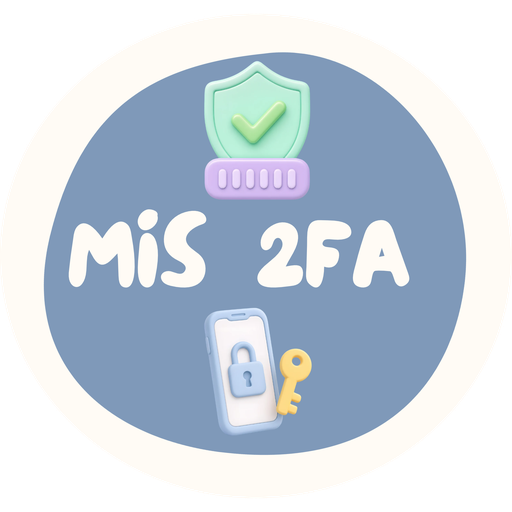

<p align="center">
  
</p>

<h1 align="center">Mis 2FA</h1>

<p align="center">
  Códigos de verificación en dos pasos para Android, libres y cifrados, con copia sincronizada en tu propio Nextcloud para no perderlos nunca.
</p>

<p align="center">
  <a href="LICENSE"></a>
  <a href="https://github.com/ferlagod/mis_2fa/actions/workflows/android.yml"></a>
  
</p>

---

Mis 2FA genera los códigos de 6 u 8 cifras que te piden las webs al iniciar sesión, como Google Authenticator o Ente Auth. La diferencia: es **software libre (GPL v3)**, no necesita cuenta en ningún servicio, y si quieres guarda una copia **cifrada de extremo a extremo** en tu Nextcloud. Si pierdes el móvil, instalas la app en otro, conectas tu Nextcloud y tus códigos vuelven.

Forma parte de la familia **Mis Apps** junto a [Mis Notas](https://github.com/ferlagod/mis_notas) y Mis Podcast.

## Características

- **Añadir cuentas en un segundo**: escanea el QR con la cámara, léelo de una captura de pantalla o escribe la clave. También abre enlaces `otpauth://` de otras apps (pidiendo confirmación).
- **Importa desde otras apps**: Google Authenticator (QR de "Transferir cuentas", también en varios lotes), Aegis y 2FAS (exportación sin cifrar), Ente Auth (exportación en texto), Bitwarden, Proton Pass y cualquier lista de enlaces `otpauth://`.
- **Todos los tipos de código**: TOTP (por tiempo), HOTP (por contador) y Steam Guard; SHA-1, SHA-256 y SHA-512; de 4 a 10 cifras; cualquier periodo.
- **Pensada para usarse rápido**: toca un código para copiarlo, mira el **siguiente código** cuando al actual le quedan pocos segundos, anillo de cuenta atrás que se pone rojo al final, búsqueda que ignora acentos, cuentas fijadas arriba.
- **Papelera sin vaciado automático**: borrar una cuenta por error nunca hace que la pierdas. Al mandar algo a la papelera puedes pulsar "Deshacer".
- **Transferir una cuenta** a otro dispositivo mostrando su QR (pide tu huella antes).
- **Copias de seguridad**: exportación cifrada con contraseña (recomendada) o en texto `otpauth://` para cambiar de app.
- **Sincronización con Nextcloud** (WebDAV) automática: al hacer un cambio, al abrir la app y cada pocas horas en segundo plano.
- **Diseño de la familia Mis Apps**: tipografías Outfit e Inter, azul acero del logo como color principal con acentos menta y lavanda, tema claro, oscuro o del sistema con opción de negro puro AMOLED, e icono temático en Android 13+.
- **Disponible en español, inglés, francés, alemán e italiano**.
- Sin anuncios, sin rastreadores, sin servicios de Google (el escáner usa ZXing, no ML Kit).

## Seguridad

- **En el teléfono**, las cuentas se guardan cifradas con AES-256-GCM usando una clave del **Android Keystore** (en el chip seguro StrongBox si el móvil lo tiene). Esa clave no puede salir del dispositivo: ni la propia app puede leerla.
- **Bloqueo de la app** con biometría fuerte (clase 3) o el PIN del dispositivo, inmediato o tras 1 o 5 minutos en segundo plano.
- **Antes de exportar o mostrar un QR** se vuelve a pedir la huella o el PIN.
- **Capturas de pantalla bloqueadas** y contenido oculto en "Recientes" (desactivable).
- **Portapapeles**: los códigos se marcan como sensibles (Android 13+ no los muestra en la vista previa) y se borran a los 30 segundos.
- Opción de **ocultar los códigos** hasta tocarlos.
- **Sin copia en la nube de Google** ni transferencia entre dispositivos: la copia es tuya, en tu Nextcloud o en el fichero que exportes.
- **Solo HTTPS**: la app rechaza servidores `http://`.

Los detalles están en [SECURITY.md](SECURITY.md) y en el [formato de sincronización](docs/SYNC_FORMAT.md).

## Cómo nunca pierdes un código

Varias capas, de la más cercana a la más lejana:

1. **Escritura atómica**: si el móvil se apaga mientras se guarda, se conserva la versión anterior completa.
2. **Instantáneas automáticas** cifradas en el dispositivo (hasta 15, como mucho una por hora). Si el fichero principal se daña, la app se recupera sola de la más reciente.
3. **Papelera** sin vaciado automático.
4. **Nextcloud**: copia cifrada que se actualiza en cuanto cambias algo. Nextcloud además guarda versiones anteriores del fichero.
5. **Sincronización que solo suma**: que una cuenta falte en el servidor (o en otro móvil) nunca la borra. Solo un borrado definitivo hecho por ti desde la papelera se propaga.
6. **Exportación cifrada** manual, para guardar donde quieras.

## Instalación

1. Descarga el último `.apk` desde la página de [Releases](https://github.com/ferlagod/mis_2fa/releases).
2. Ábrelo en tu teléfono y permite la instalación desde esa fuente si Android te lo pide.

Requisitos: Android 8.0 (API 26) o superior.

## Conectar con Nextcloud

1. En la web de tu Nextcloud ve a **Ajustes personales → Seguridad → Dispositivos y sesiones** y crea una **contraseña de aplicación** (por ejemplo "Mis 2FA"). No uses tu contraseña normal.
2. En la app, abre **Ajustes** (engranaje) → **Sincronización** e introduce:
   - **Servidor**: la dirección de tu Nextcloud, p. ej. `https://nube.ejemplo.com`.
     También puedes pegar una URL WebDAV completa (`https://…/remote.php/dav/files/usuario/carpeta`).
   - **Usuario** y la **contraseña de aplicación** del paso 1.
   - **Contraseña maestra**: la que cifra tus códigos (mínimo 8 caracteres).
3. Pulsa **Conectar y cifrar**. La app crea la carpeta `Mis2FA` en tu Nextcloud y sube tus cuentas cifradas en `Mis2FA/vault.json`.

### Usar varios dispositivos

Instala la app en el otro dispositivo y conéctalo con la **misma cuenta y la misma contraseña maestra**. Las cuentas de los dos se juntan. Si la contraseña no es la correcta, la app te avisa y no sube nada.

Puedes **cambiar la contraseña maestra** desde Ajustes. El resto de tus dispositivos te pedirán la nueva en su siguiente sincronización.

> [!WARNING]
> **Si olvidas la contraseña maestra, la copia del servidor no se puede descifrar.** Ni el administrador de Nextcloud ni el autor de la app pueden recuperarla. Tus códigos seguirán en los dispositivos donde ya estén, pero guárdala en un gestor de contraseñas.

## Pasarte desde otra app

| Desde | Cómo |
|-------|------|
| **Google Authenticator** | Menú → *Transferir cuentas* → *Exportar*. En Mis 2FA, *Añadir cuenta* → *Escanear código QR*. Si salen varios QR, escanéalos todos seguidos. |
| **Aegis** | Ajustes → *Importar y exportar* → *Exportar* sin cifrar (JSON). En Mis 2FA, *Importar de otra app*. |
| **2FAS** | Ajustes → *Copia de seguridad* → *Exportar* sin contraseña. En Mis 2FA, *Importar de otra app*. |
| **Ente Auth** | Ajustes → *Datos* → *Exportar códigos* → *Texto sin cifrar*. En Mis 2FA, *Importar de otra app*. |
| **Otra app** | Cualquier exportación con un enlace `otpauth://` por línea. |

Después de importar, **borra el fichero sin cifrar**.

## Compilar desde el código

Necesitas JDK 21 y el Android SDK (Android Studio lo instala todo).

```bash
git clone https://github.com/ferlagod/mis_2fa.git
cd mis_2fa
./gradlew assembleDebug          # APK de depuración en app/build/outputs/apk/debug/
./gradlew testDebugUnitTest      # tests unitarios (incluye los vectores oficiales de RFC 4226 y 6238)
./gradlew lintDebug              # análisis estático (lo ejecuta también el CI)
```

### Firmar una versión release

1. Crea un almacén de claves (una sola vez y **guárdalo bien**: sin él no podrás publicar actualizaciones):
   ```bash
   keytool -genkeypair -v -keystore mis2fa-release.jks -alias mis2fa -keyalg RSA -keysize 4096 -validity 10000
   ```
2. Copia `keystore.properties.example` a `keystore.properties` y rellénalo. Ese fichero está en `.gitignore`.
3. Ejecuta `./gradlew assembleRelease`. El APK queda en `app/build/outputs/apk/release/`.

Para firmar en GitHub Actions, consulta [CONTRIBUTING.md](CONTRIBUTING.md#publicar-una-versión).

## Estructura del proyecto

```
app/src/main/java/com/ferlagod/mis2fa/
├── model/            Cuenta (Token) y bóveda (VaultData)
├── otp/              Generación TOTP/HOTP/Steam, Base32, enlaces otpauth:// y migración de Google
├── security/         Cifrado con contraseña (PBKDF2 + AES-GCM) y con el Android Keystore
├── data/
│   ├── local/        Bóveda cifrada del dispositivo, instantáneas, credenciales y preferencias
│   ├── remote/       Cliente WebDAV (OkHttp)
│   ├── sync/         Formato cifrado, reglas de fusión, sincronización y WorkManager
│   ├── backup/       Importar de otras apps y exportar
│   └── TokenRepository.kt
├── ui/               Pantallas Jetpack Compose, componentes y tema
└── util/             Bloqueo, portapapeles seguro, QR (ZXing), idioma y búsqueda

app/src/main/res/values*/strings.xml   Textos (inglés por defecto; es, fr, de, it)
```

## Contribuir

Las contribuciones son bienvenidas. Lee [CONTRIBUTING.md](CONTRIBUTING.md) antes de abrir un *pull request*. Para vulnerabilidades, sigue [SECURITY.md](SECURITY.md).

## Créditos

- Tipografías [Outfit](https://github.com/Outfitio/Outfit-Fonts) (© 2021 The Outfit Project Authors) e [Inter](https://github.com/rsms/inter) (© 2016 The Inter Project Authors), bajo la [SIL Open Font License 1.1](https://openfontlicense.org). La licencia va incluida en los propios ficheros de fuente.
- Lectura y generación de códigos QR con [ZXing](https://github.com/zxing/zxing) (Apache 2.0).

## Licencia

Copyright © 2026 ferlagod

Este programa es software libre: puedes redistribuirlo y/o modificarlo bajo los términos de la **Licencia Pública General de GNU** publicada por la Free Software Foundation, ya sea la versión 3 de la Licencia o (a tu elección) cualquier versión posterior.

Se distribuye con la esperanza de que sea útil, pero **SIN NINGUNA GARANTÍA**; ni siquiera la garantía implícita de COMERCIABILIDAD o IDONEIDAD PARA UN PROPÓSITO PARTICULAR. Consulta el fichero [LICENSE](LICENSE) para más detalles.

*Nextcloud es una marca registrada de Nextcloud GmbH. Este proyecto no está afiliado a Nextcloud GmbH, Google, Ente, Aegis, 2FAS ni Valve.*
